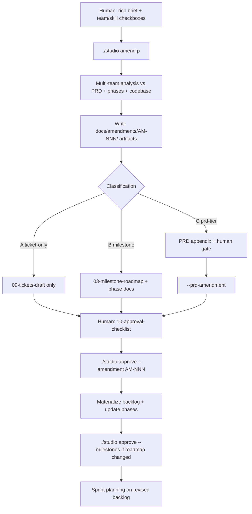

# Amendment intake — post-launch product direction

> **When:** After gate 2 and an approved milestone roadmap — **before** kicking off the next milestone if strategic direction has changed.  
> **Purpose:** Turn a **rich vision brief** into analyzed scope: requirements addendum, UX concepts, FE/BE architecture, tooling impact, **revised milestones/phases**, and groomed tickets.

---

## Problem this solves

| Source | Good for | Gap |
|--------|----------|-----|
| PRD (`docs/intake/prd.md`) | Vision, audience, P0/P1 tiers | Frozen after gate 0; heavy to change |
| Sprint `feedback` | Small, concrete ideas | One theme at a time; no strategic decomposition |
| `revisions.md` | One-line scope notes | No analysis, teams, or ticket breakdown |
| Pre-planned M6+ | Sequenced delivery | May be **wrong order** if new direction lands mid-flight |

**Amendments** fill the middle: *"We're going toward agencies / AI palette / mobile-first share"* — enough narrative for the studio to **weave into the running project**, not just add tickets.

**Rule:** Do not start the next milestone (e.g. M6 limits & billing) until pending amendments are analyzed and the **revised roadmap** is human-approved.

---

## Mental model: four product layers

```
PRD (constitution)          ← rare changes; class C may trigger PRD patch
    ↓
docs/phases/ (roadmap)      ← M* outlines; amendment REWRITES or INSERTS phases
    ↓
docs/amendments/AM-NNN/     ← analysis artifacts (vision → arch → tickets-draft)
    ↓
backlog/*.md (tickets)      ← execution after amendment approve + groom
```

Amendment intake **does not** replace sprint feedback. Use feedback for review nits; use amendments for **new strategic direction**.

---

## File layout

### Drop zone (human, gitignored like PRD intake)

```
quinsy-studio/
└── intake/
    └── amendments/
        └── <project>/
            └── amendment_01.md             # human copy (not committed)
```

### Studio templates (committed, project-agnostic)

```
.quinsy-studio/studio-templates/
├── amendment_template.md
└── amendment_01.example.md                 # full fictional example (acme-app)
```

### Processed artifacts (project repo)

```
projects/<p>/
└── docs/
    └── amendments/
        ├── README.md
        └── AM-001-<slug>/
            ├── source.md
            ├── 01-vision-synthesis.md
            ├── 02-requirements-addendum.md
            ├── 03-milestone-roadmap.md      # ← milestones derived HERE, not in intake brief
            ├── 04-ui-ux-concept.md
            ├── 05-frontend-architecture.md
            ├── 06-backend-architecture.md
            ├── 07-tooling-and-process.md
            ├── 08-adrs/                     # optional
            ├── 09-tickets-draft.md
            └── 10-approval-checklist.md
```

After human approval, ticket stubs become real `backlog/<PREFIX>-xxxx.md` files (project prefix); `docs/phases/` is updated per `03-milestone-roadmap.md`.

---

## Amendment brief (human input)

**Template:** [studio-templates/amendment_template.md](../studio-templates/amendment_template.md)  
**Full example:** [studio-templates/amendment_01.example.md](../studio-templates/amendment_01.example.md)

### Human fills

| Section | Purpose |
|---------|---------|
| Executive summary, why now | Context and urgency |
| Vision & concept | North-star, scenarios, principles, fit with current product |
| Scope boundaries | In / out / non-goals |
| Success picture | Qualitative + measurable signals |
| Constraints & dependencies | Legal, perf, billing deps, timeline gut feel |
| Open questions | What analysis must answer |
| **Team selection** | Check applicable teams from full catalog (01–10) |
| **Skill selection** | Check applicable skills (FE-*, BE-*, UX-*, …) |
| References | Links, competitors, screenshots |

### Human does **not** fill

- Milestones or phase numbers (M6, M7, …)
- Ticket IDs or sprint tags
- Architecture decisions (agent proposes in analysis)
- BDD acceptance criteria (agent drafts in `09-tickets-draft.md`)

---

## Process flow



### Step 1 — Capture

```bash
cp .quinsy-studio/studio-templates/amendment_01.example.md intake/amendments/<project>/amendment_01.md
# Edit vision sections; check teams + skills only
```

Tell the agent: *"Run amendment intake for `<project>` amendment_01"*

### Step 1.5 — Overlap check (mandatory, before analyze)

**Before drafting new analysis, check whether an existing amendment already covers this scope**
(LO-0050). Run `./studio amendments <project>` and grep `docs/amendments/*/01-vision-synthesis.md`
+ `intake/amendments/<project>/*.md` for related themes/keywords from the new brief. If an
approved-but-dormant amendment overlaps (tickets exist but were never scheduled, or milestones
were never inserted into `docs/phases/`), **reconcile with it instead of drafting a parallel one**:
write a short reconciliation doc under the existing amendment's folder (e.g. `docs/amendments/
AM-00N-.../NN-reconciliation-<other-AM>.md`) mapping overlapping fields/decisions, and route any
new work as tickets/milestone-inserts against the existing amendment. Only draft a genuinely new
amendment when no existing one covers the scope.

### Step 2 — Analyze (agent)

```bash
./studio amend <project> intake/amendments/<project>/amendment_01.md
```

Agent **must read**:

- Amendment brief (checked teams + skills)
- `docs/intake/prd.md` + `docs/definitions/`
- `docs/phases/README.md` + all M* docs (including planned M6+)
- Current codebase surface area touched by the vision
- [ticket-team-allocation.md](ticket-team-allocation.md) + [skill-registry.md](../teams/skill-registry.md)
- [contextual-ia-playbook.md](../knowledge-base/contextual-ia-playbook.md) for surface placement
- Open feedback queue (related themes)
- **Existing/approved amendments found in Step 1.5** — do not silently duplicate their scope

Agent **produces** `docs/amendments/AM-001-<slug>/`:

| Artifact | Lead team | Content |
|----------|-----------|---------|
| `01-vision-synthesis.md` | 04 / 06 | Consolidated narrative, PRD fit, conflicts |
| `02-requirements-addendum.md` | 06 | New FR/NFR, personas, journeys, acceptance themes, **and a "Scope exclusions" table** (see below) |
| `03-milestone-roadmap.md` | 04 / 06 | **Proposed M* insert/reorder/defer** |
| `04-ui-ux-concept.md` | 10 | Flows, **contextual IA / surface map**, design-track ticket list |
| `05-frontend-architecture.md` | 01 | Routes, components, state, studio-library impact |
| `06-backend-architecture.md` | 02 | APIs, schema, integrations, email/billing touchpoints |
| `07-tooling-and-process.md` | 08 / 09 | CI, env, Docker, new `./studio` commands if needed |
| `08-adrs/` | 04 | Only when a decision blocks tickets |
| `09-tickets-draft.md` | all selected teams | Stubs: team, skills, type, milestone tag, estimate |
| `10-approval-checklist.md` | — | Human sign-off items before materialize |

**Scope exclusions table (mandatory in `02-requirements-addendum.md`, LO-0049):** any requirement
that freezes, excludes, or explicitly does **not** touch a system a reasonable reader would expect
to be in scope (e.g. an amendment titled “agency client surfaces” that excludes the companion plugin)
must be listed explicitly:

| Excluded/frozen system | Requirement enforcing it | Why | Reversible later? |
|---|---|---|---|
| e.g. Companion plugin contract | FR-NNN (byte-compatible) | Non-regression during web-first delivery | Yes — revisit in a follow-up amendment |

This table is surfaced verbatim in `10-approval-checklist.md` so the human sees it **at
approval time**, not during a later sprint review.
Set `docs/amendments/README.md` status → `analyzed`.

### Step 3 — Classify

| Class | Meaning | Gate |
|-------|---------|------|
| **A — ticket** | Fits existing milestone after minor roadmap tweak | Amendment approve |
| **B — milestone** | New or reordered M*; update `docs/phases/M*.md` + README | Amendment approve + **`--milestones`** |
| **C — prd** | Changes audience, KPIs, or P0/P1 tier | `--prd-amendment` then amendment approve |

### Step 4 — Human approve

```bash
./studio approve <project> --amendment AM-001
./studio approve <project> --milestones          # if 03-milestone-roadmap.md changed M*
./studio approve <project> --prd-amendment AM-001   # class C only
```

Until approved: **no implementation**, no `sprint:` tags.

### Step 5 — Materialize

On approve, agent:

1. Merge `09-tickets-draft.md` → `backlog/<PREFIX>-xxxx.md` (groomed BDD)
2. Apply `03-milestone-roadmap.md` → `docs/phases/` (new M* docs, README, dependency chain)
3. Append `docs/phases/revisions.md`
4. Update `docs/amendments/README.md` → `approved`
5. Design-track tickets: Team 10 spec with §2 Context & placement → `./studio approve-design` before implement

Then: `./studio sprint <project>` → scope from revised backlog.

---

## Team & skill selection (human)

Human **checks** teams and skills in the brief. Agent:

- Uses checked teams as **minimum** involvement
- May add support teams with rationale in `10-approval-checklist.md`
- Maps checked skills to each ticket stub (max ~5 skills per ticket at implement time)
- Loads team skill files from `.quinsy-studio/teams/<NN>-*/skills/`

Full catalogs: [ticket-team-allocation.md](ticket-team-allocation.md), [skill-registry.md](../teams/skill-registry.md).

| Amendment theme | Typical teams |
|-----------------|---------------|
| New UI surface | 10 → approve-design → 01 |
| API / billing / email | 02 |
| Cross-cutting (collab, export) | 02 + 01; 10 if UX changes |
| Go-to-market / positioning | 05 + 10 (UX-007) |
| Compliance-heavy feature | 03 + 02 |
| **Surface / IA shift** | 10 (UX-003) first → then 01 |

---

## CLI surface

| Command | Action |
|---------|--------|
| `./studio amend <p> <file>` | Run analysis → `docs/amendments/AM-NNN/` |
| `./studio amendments <p>` | List amendments + status |
| `./studio approve <p> --amendment AM-NNN` | Human sign-off; materialize tickets |
| `./studio approve <p> --prd-amendment AM-NNN` | PRD tier change (class C) |

Implemented in `.quinsy-studio/studio-tools/amendment_intake.py` (wired in `studio.py`).

---

## Relationship to existing flows

| Flow | Use when |
|------|----------|
| `./studio feedback` | Sprint review nits; single-theme ideas |
| `./studio amend` | Strategic direction; multi-artifact analysis |
| `./studio revise --gate N` | Pre-implementation only (gates 0–2) |
| Milestone review | Close M*; approve before next milestone **unless** amendment pending |

**Rules:**

- Amendments never skip design HITL for UI.
- Amendments never auto-tag `sprint:` — groom + sprint scope approval still required.
- **Do not kick off pre-planned next milestone** until amendment cycle completes and roadmap re-approved.
- Amendment `04-ui-ux-concept.md` must include **surface map** when new UI surfaces or moved capabilities are involved.

---

## Agent obligations

1. **Analyze before ticket** — no `backlog/*.md` from raw amendment without full AM-NNN folder
2. **Derive milestones in analysis** — `03-milestone-roadmap.md`, not from human brief
3. **Map every ticket stub** — `milestone: M*`, `team`, `skills`, `ticket_type`
4. **Flag PRD conflict** — class **C**, stop implementation path
5. **Contextual IA** — UX-003 placement before layout specs in `04-ui-ux-concept.md`
6. **Log** — `revisions.md` on approve
7. **Do not implement** until amendment approved, milestones re-approved if changed, tickets groomed
8. **Cross-surface acceptance check** (LO-0048) — before marking the last ticket of an amendment's capability `done`, re-read `02-requirements-addendum.md` / `04-ui-ux-concept.md` for every **surface** the capability was promised on (e.g. marketing + application + atoms). A ticket proving distinctness on *one* surface does not close the capability for surfaces it didn't touch — list the untouched surfaces explicitly in the ticket or file a follow-up.
9. **Unread-field check** (LO-0048) — before milestone review, search every field added to a frozen type in `docs/amendments/AM-NNN-*/` for at least one **runtime reader** under the project’s application code (`src/`, `app/`, `packages/`, etc. — not only the type’s own definition module). A field with zero readers ships silently inert — flag it in the review brief rather than letting gate-green imply coverage.
10. **Live home-surface check** (LO-0057 / LO-0059) — before writing or grooming UI tickets that place a capability on an amendment surface (kit slots, brand guide, share dialog, …), confirm that surface is still the **live product home**. If shipped UX or later feedback moved the capability, update the amendment surface map or open clarifying feedback — do not scope a sprint against stale IA alone.
---

## Example (fictional project `acme-app`)

**State:** M5 complete. M6 (limits & billing) documented but **not active** — amendment intake runs first.

**Brief (intake):** Rich vision for agency positioning + checked teams 01, 02, 10, 04, 05.

**Analysis output (sketch):**

- **Class B** — inserts **M5.1 Agency surfaces** before M6; defers billing until agency share/export stable
- **04-ui-ux-concept.md** — surface map: Share = canvas + invite; presentation builder = client link + guest access
- **05/06** — team seat model API, export watermark brand tokens
- **09-tickets-draft.md** — stubs across M5.1 and revised M6

Human approves amendment + `--milestones` → backlog populated → sprint planning.

---

## References

- [milestone-planning.md](milestone-planning.md)
- [human-in-the-loop.md](human-in-the-loop.md)
- [ticket-team-allocation.md](ticket-team-allocation.md)
- [contextual-ia-playbook.md](../knowledge-base/contextual-ia-playbook.md)
- [studio-abstraction.md](studio-abstraction.md)
- [studio-templates/amendment_template.md](../studio-templates/amendment_template.md)
- [studio-templates/amendment_01.example.md](../studio-templates/amendment_01.example.md)
