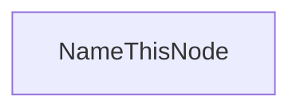

# As-built — architecture

> Runtime topology of **this** tree. Do not invent a greenfield stack. Cite paths.

## Runtime

_TODO_ — processes, hosts, how the app boots.

## Packages / modules

| Area | Path | Role |
|------|------|------|
| _TODO_ | | |

## Integrations

| System | Client path | Notes |
|--------|-------------|-------|
| _TODO_ | | |

## Diagram (optional)

