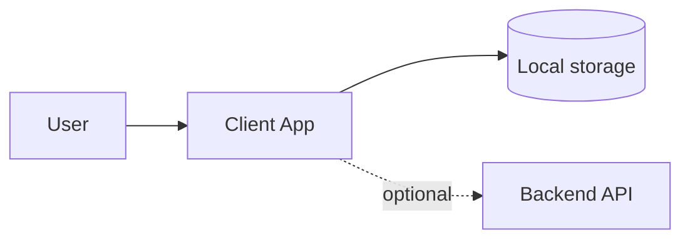

# Architecture Blueprint — {{PROJECT}}

> **Status:** draft (waiting for human gate 1)
> **Date:** {{DATE}}
> **Archetype:** {{ARCHETYPE}}

## System overview

_Describe the system in plain language. Who uses it, what runs where._

## Tech stack

| Layer | Choice | Rationale |
|-------|--------|-----------|
| Frontend | Next.js App Router | Product routes. Studio-library styles them. |
| Styling | Project tokens + studio-library | `/admin` stays Payload's own UI. |
| Data / storage | Postgres via Payload | Uploads: local disk in dev, Cloudflare R2 in production. |
| Backend / sync | Payload | Auth, collections, Local API, jobs. |
| Deployment | Coolify on a VPS | Local boot is Docker Desktop. |

## Payload

Payload: in
Locales: en
Fallback locale: en
Surfaces: website, webapp
Plugins: stripe later, seo later, multi-tenant n/a, import-export n/a, mcp n/a
Profiles: base

Change `Payload: in` to `Payload: out` only with an ADR that opts out. A game or an API service may omit this section. Add a locale to `Locales:` only when the PRD names that language. List a Compose profile (`redis`, `pooler`, `minio`, `rag`) on `Profiles:` when the product uses it.

## Architecture diagram

## Security & compliance

- Authentication approach:
- Data residency:
- GDPR notes:

## Non-functional requirements

| Requirement | Target | How we meet it |
|-------------|--------|----------------|
| Performance | | |
| Offline | | |
| Accessibility | | |

## ADRs

_List links to `docs/adr/ADR-*.md`._

## Open questions

_Move unresolved items to `docs/definitions/11-assumptions.md`._
