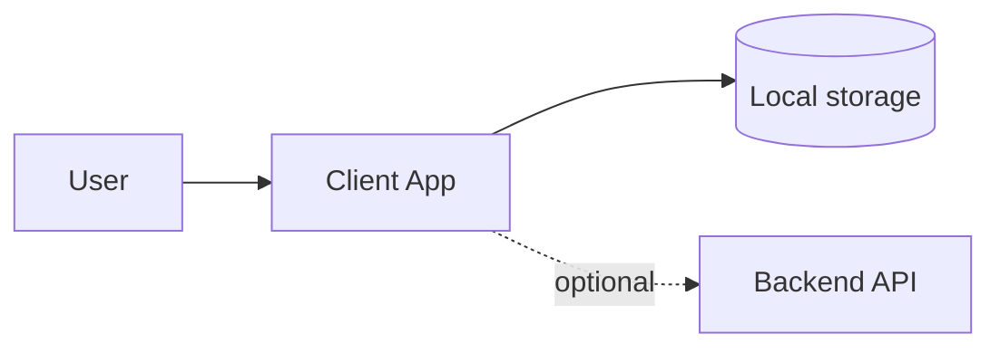

# Architecture Blueprint — {{PROJECT}}

> **Status:** draft (waiting for human gate 1)
> **Date:** {{DATE}}
> **Archetype:** {{ARCHETYPE}}

## System overview

_Describe the system in plain language. Who uses it, what runs where._

## Tech stack

| Layer | Choice | Rationale |
|-------|--------|-----------|
| Frontend | | |
| Styling | | |
| Data / storage | | |
| Backend / sync | | |
| Deployment | | |

## Architecture diagram

## Security & compliance

- Authentication approach:
- Data residency:
- GDPR notes:

## Non-functional requirements

| Requirement | Target | How we meet it |
|-------------|--------|----------------|
| Performance | | |
| Offline | | |
| Accessibility | | |

## ADRs

_List links to `docs/adr/ADR-*.md`._

## Open questions

_Move unresolved items to `docs/definitions/11-assumptions.md`._
